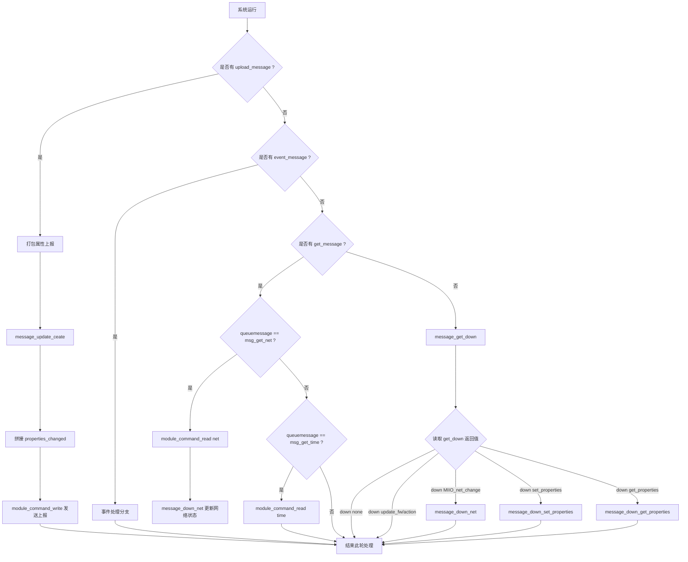

# bsp_module.c 模组功能说明

## 1. 模组功能定位

`bsp_module.c` 主要负责与外部模组进行串口通信，完成以下几类任务：

- 通过 LPUART1 与 WiFi/通信模组通信；
- 发送 AT 命令、读取响应、判断命令执行结果；
- 组装设备身份识别码和版本信息；
- 上报设备状态、故障、报警和参数信息；
- 处理模组下发的网络状态、属性设置、属性查询和固件更新指令；
- 通过消息队列分发上传、查询和下行事件。

对应代码位置：

- [source/bsp_module.c](../source/bsp_module.c)

## 2. 关键功能描述

### 2.1 模组串口通信

文件中使用 `lpuart_senddata(M0P_LPUART1, ...)` 进行发送，定义了：

- `module_send(a)`：发送单个字符；
- `module_send_string(char *str)`：发送字符串；
- `module_command_write()`：发送命令并等待 ACK；
- `module_command_read()`：发送命令并读取返回值。

这些函数实现了与模组命令交互的基本机制，并通过 `module_re_done`、`module_re_length` 和 `module_re_buf` 监控串口应答状态。

### 2.2 设备身份与版本信息

`PackageIdentityCodeData()` 用于生成设备识别码，采用公司代码、网络类型、设备类型分配码和 CRC 校验。

同时：

- `message_packet_pid()`：上报设备型号；
- `message_packet_version()`：上报 MCU 版本号。

这些信息用于设备接入模组平台时的设备注册和识别。

### 2.3 设备状态判定

函数 `get_device_status()` 会根据当前设备状态，返回不同的工作状态：

- 预热中：返回 0；
- 报警中：返回 5；
- 测试中：返回 2；
- 寿命到期：返回 3；
- 默认正常：返回 1。

`get_device_fault()` 则汇总故障状态：

- `f_fault_gas` -> 气体故障；
- `f_fault_valve` -> 阀门故障；
- 以位掩码方式返回。

### 2.4 状态上报

`message_update_ceate(unsigned char date)` 根据不同事件，构造并打包属性上报内容，例如：

- 预热进入/退出；
- 检查运行；
- 报警进入/退出；
- 传感器故障/阀门故障；
- 气体浓度上报；
- 使用寿命上报；
- 报警消音状态上报；
- 设备序列号上报。

它通过 `message_packet_param()` 和 `message_packet_string()` 生成上报包。

### 2.5 下行指令处理

模组下发的命令通过 `message_get_down()` 解析：

- `down MIIO_net_change` -> `message_down_net()`
- `down set_properties` -> `message_down_set_properties()`
- `down get_properties` -> `message_down_get_properties()`
- `down update_fw` -> 升级相关处理
- `down action` -> 动作命令处理

其中：

- `message_down_net()` 更新网络状态：offline / local / cloud / updating / uap / unprov；
- `message_down_set_properties()` 处理属性写入，例如 `2 5` 报警静音参数；
- `message_down_get_properties()` 处理属性读取和回包生成。

### 2.6 消息分发总入口

`module_message_dispose()` 是整个模组通信的入口：

- 如果有上传消息，打包后上报；
- 如果有事件消息，暂时为空实现；
- 如果有查询消息，读取模组网络或时间；
- 如果没有以上消息，则轮询处理下行消息。

这使得整个模组功能被统一到一个消息处理循环中，便于扩展和维护。

## 3. Mermaid 流程图

## 4. 一句话总结

`bsp_module.c` 是整套设备与模组通信的核心文件，负责模组命令交互、设备状态上报、参数读取/设置以及网络状态同步，是实现设备联网和云端控制的关键模块。
