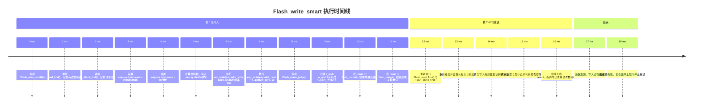

# Flash_write_smart 时间线图

## 关键说明

- `Flash_write_smart` 采用“最多重试 8 次”的方式写入 EEPROM/Flash 参数。
- 每次写入前都会先调用 `Flash_read_find` 和 `Flash_blank_find`，以定位有效页和空白页。
- 写入前会更新头标志位和校验和，然后执行一次实际写入。
- 若 `Flash_Write` 返回正常值 `flash_normal`，则结束循环；否则继续尝试直到上限。
- 逻辑中还会在写入后调用 `Flash_erase_judge`，用于根据地址判断是否需要擦除旧页。

