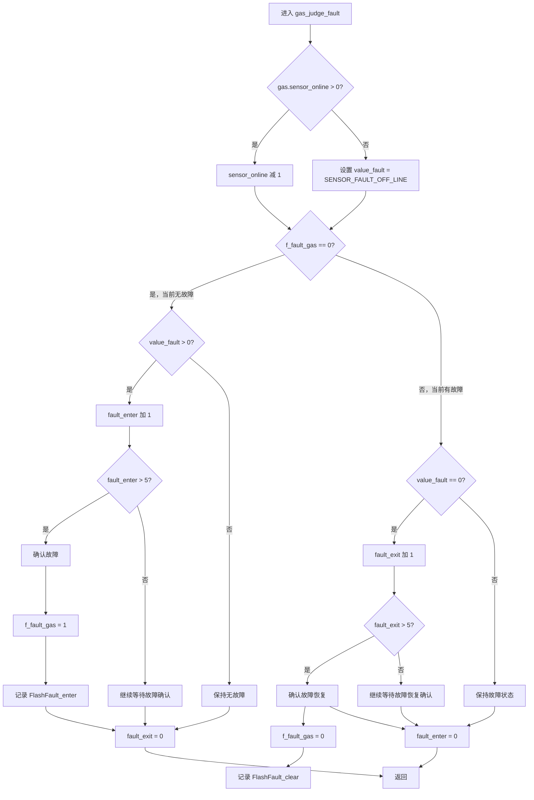
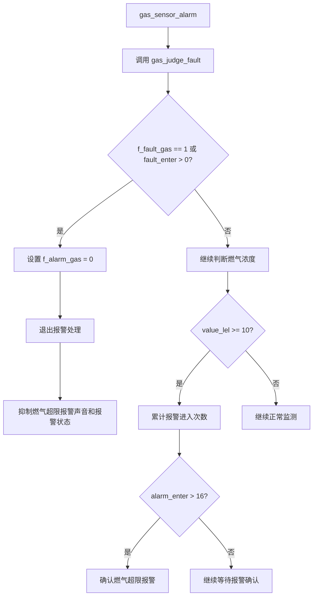
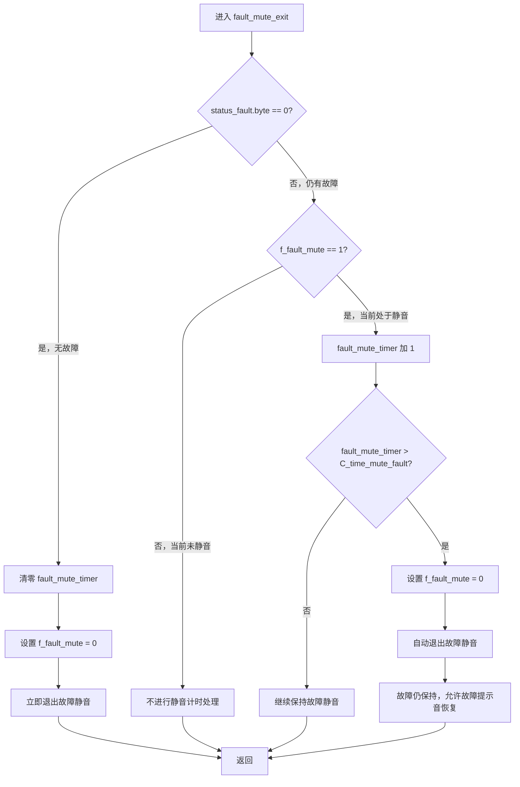
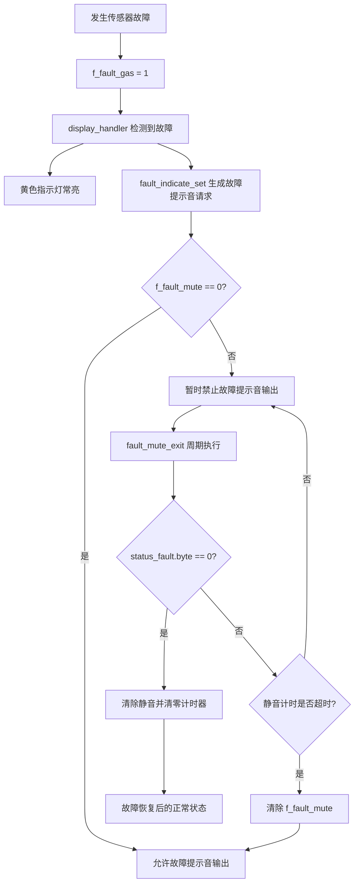

# 燃气传感器故障检测与故障消音说明

## 1. 功能概述

`gas_judge_fault()` 用于判断燃气传感器是否发生故障，并通过连续计数避免瞬时通信异常或传感器抖动导致误报。

该函数主要完成以下工作：

- 维护传感器在线状态计数；
- 判断传感器是否离线或上报故障；
- 连续确认故障进入；
- 连续确认故障恢复；
- 记录故障进入和故障恢复日志。

## 2. 传感器在线状态判断

在 `gas_sensor_analysis()` 中，接收到校验正确的传感器数据后，将：

```c
gas.sensor_online = 3;
```

`gas_judge_fault()` 每调用一次就将 `gas.sensor_online` 减 1：

```c
if(gas.sensor_online > 0)
{
    gas.sensor_online--;
}
else
{
    gas.value_fault = SENSOR_FAULT_OFF_LINE;
}
```

当在线计数减至 0 后仍未收到有效传感器数据，系统将 `gas.value_fault` 设置为 `SENSOR_FAULT_OFF_LINE`，表示传感器离线故障。

传感器故障类型定义如下：

| 故障码 | 含义 |
| --- | --- |
| `0x00` | 无故障 |
| `0x02` | 脉冲最大故障 |
| `0x04` | 光源过强 |
| `0x08` | 光源过弱 |
| `0x10` | 校准故障 |
| `0x20` | 检测故障 |
| `0x40` | 温度故障 |
| `0x80` | 传感器离线 |

## 3. 故障进入判断

当 `f_fault_gas == 0` 时，系统当前处于无故障状态。

如果 `gas.value_fault > 0`，则故障进入计数器 `gas.fault_enter` 加 1。当计数值大于 5 时，确认故障进入：

```c
f_fault_gas = 1;
log_write(FlashFault_enter);
```

因此，按照当前代码逻辑，需要连续 6 次检测到故障才会确认故障进入。确认过程中，`gas.fault_exit` 会被清零。

## 4. 故障恢复判断

当 `f_fault_gas == 1` 时，系统当前处于故障状态。

如果 `gas.value_fault == 0`，则故障退出计数器 `gas.fault_exit` 加 1。当计数值大于 5 时，确认故障恢复：

```c
f_fault_gas = 0;
log_write(FlashFault_clear);
```

因此，按照当前代码逻辑，需要连续 6 次检测正常才会确认故障恢复。故障状态下，`gas.fault_enter` 会被清零。

## 5. 故障消音与报警抑制

`gas_judge_fault()` 本身不直接控制蜂鸣器，而是通过设置全局故障标志 `f_fault_gas`，由 `gas_sensor_alarm()` 执行燃气报警抑制：

```c
if((f_fault_gas) || (gas.fault_enter > 0))
{
    f_alarm_gas = 0;
    return;
}
```

当传感器故障已经确认，或者故障正在连续确认过程中时：

- 清除燃气报警标志 `f_alarm_gas`；
- 退出后续燃气浓度报警判断；
- 防止传感器故障期间继续触发燃气超限报警；
- 避免燃气超限报警声音与传感器故障状态同时发生。

这里实现的是**燃气报警消音或抑制**，并不表示关闭所有故障提示音。故障状态下是否产生专用故障提示音，需要结合 `bsp_sound_led.c` 中对 `f_fault_gas` 的处理进行确认。

## 6. 故障检测流程图



## 7. 故障消音流程图



## 8. 状态转换总结

| 当前状态 | 判断条件 | 处理结果 |
| --- | --- | --- |
| 无故障 | `value_fault > 0` 连续超过 5 次 | 设置 `f_fault_gas = 1`，记录故障进入日志 |
| 无故障 | `value_fault == 0` | 清零 `fault_exit`，保持正常 |
| 有故障 | `value_fault == 0` 连续超过 5 次 | 设置 `f_fault_gas = 0`，记录故障恢复日志 |
| 有故障 | `value_fault > 0` | 清零 `fault_enter`，保持故障 |
| 故障确认或确认中 | `f_fault_gas == 1` 或 `fault_enter > 0` | 清除 `f_alarm_gas`，抑制燃气报警 |

## 9. 故障静音退出说明

`fault_mute_exit()` 用于管理故障提示音静音状态 `f_fault_mute` 的退出。该函数不清除 `f_fault_gas`，只控制故障声音是否恢复。

### 9.1 无故障时立即退出静音

当 `status_fault.byte == 0` 时，系统没有有效故障：

```c
device.fault_mute_timer = 0;
f_fault_mute = 0;
```

处理结果如下：

- 清零故障静音计时器 `device.fault_mute_timer`；
- 清除故障静音标志 `f_fault_mute`；
- 为下一次故障提示音重新启用做好准备。

### 9.2 故障持续时自动退出静音

当 `status_fault.byte != 0` 时，系统仍存在故障：

- 如果 `f_fault_mute == 0`，不进行静音计时处理；
- 如果 `f_fault_mute == 1`，则 `device.fault_mute_timer` 持续加 1；
- 当计时器大于 `C_time_mute_fault` 时，清除 `f_fault_mute`，故障提示音恢复。

故障静音退出后，故障本身仍然存在，`f_fault_gas` 不会被清除。`display_handler()` 仍会通过黄色指示灯和 `fault_indicate_set(INDICATE_FAULT_SENSOR)` 表示传感器故障，但由于 `f_fault_mute` 已清零，后续故障提示音可以再次产生。

## 10. 故障静音退出流程图



## 11. 故障静音与故障状态关系



> 注：`fault_mute_exit()` 的“自动退出静音”只恢复故障声音输出权限，不代表传感器故障已经恢复。故障是否恢复仍由 `gas_judge_fault()` 根据 `gas.value_fault` 和 `fault_exit` 计数确认。
