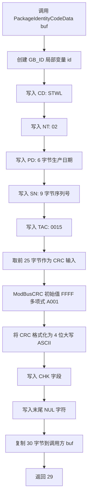

# `PackageIdentityCodeData` 身份识别码生成说明

## 1. 函数概述

函数位置：[source/bsp_module.c](../source/bsp_module.c)

```c
unsigned char PackageIdentityCodeData(unsigned char *buf)
```

`PackageIdentityCodeData()` 将设备身份信息组装为固定格式的 ASCII 字符串，计算前 25 个字节的 Modbus CRC16，并把 CRC 结果转换为 4 位大写十六进制 ASCII 字符写入识别码末尾。

调用方需要提供至少 30 字节的缓冲区。函数向该缓冲区写入 29 个有效字符和 1 个字符串结束符 `\0`，最后返回 `29`。

## 2. 身份识别码格式

识别码由以下字段顺序组成：

| 字段 | 长度 | 当前来源 | 含义 |
| --- | ---: | --- | --- |
| `CD` | 4 | `AEP_MANUFACTURER_CODE` = `STWL` | 公司代码 |
| `NT` | 2 | `AEP_NETWORKTYPE` = `02` | 网络类型，注释定义 `01` 为 NB-IoT、`02` 为 CAT.1 |
| `PD` | 6 | 当前未写入 | 生产日期，预留格式为 `YYMMDD` |
| `SN` | 9 | 当前未写入 | 序列号，代码注释预留 9 位编码 |
| `TAC` | 4 | `AEP_DEVICE_TYPE_ALLOCATION` = `0015` | 类型分配码 |
| `CHK` | 4 | 前 25 字节的 CRC16 | Check Code，大写 ASCII 十六进制 |
| 合计 | 29 |  | 不包含末尾 `\0` |

因此，字段格式可以表示为：

```text
CD(4) + NT(2) + PD(6) + SN(9) + TAC(4) + CHK(4)
```

当 `PD` 和 `SN` 被正确填充时，识别码的前 25 字节为：

```text
STWL02 + YYMMDD + SSSSSSSSS + 0015
```

例如，假设生产日期为 `250101`、序列号为 `000102030`，CRC 输入数据应为：

```text
STWL02250101000102030015
```

上面的示例仅用于说明字段排列，实际 CRC 应由程序对不含空格的 25 字节序列计算。

## 3. CRC16 计算规则

函数调用：

```c
calCrc16 = ModBusCRC(&id.buf[0], 25);
```

`ModBusCRC()` 的参数和算法如下：

- 初始值：`0xFFFF`；
- 多项式：`0xA001`；
- 每个输入字节先与 CRC 异或；
- 每个字节循环处理 8 次；
- 若最低位为 1，则右移后再与 `0xA001` 异或，否则仅右移；
- 计算范围：`CD`、`NT`、`PD`、`SN`、`TAC`，共 `4 + 2 + 6 + 9 + 4 = 25` 字节；
- CRC 结果使用 `sprintf(..., "%04X", calCrc16)` 转换为 4 位大写十六进制文本。

## 4. 生成流程



## 5. 当前实现注意事项

当前源码中 `PD` 和 `SN` 的两段 `sprintf()` 被注释掉：

```c
// sprintf(id.id_head.pd, ...);
// sprintf(id.id_head.sn, ...);
```

由于 `GB_ID id` 是未初始化的局部变量，`PD` 和 `SN` 位置可能包含任意栈数据。它们随后被纳入 CRC 计算，因此当前函数生成的识别码可能每次不同，也可能包含不可打印字符。

若要得到稳定的身份识别码，应在计算 CRC 前始终填充 `PD` 和 `SN`，或先将 `id` 清零并明确写入这两个字段。补齐后再使用本文的 25 字节 CRC 规则进行校验。

## 6. 识别码上报位置

在 `message_update_ceate()` 中，当事件为 `msg_upload_serial_number` 时：

1. 调用 `PackageIdentityCodeData()` 生成识别码；
2. 通过 `message_packet_string(5, 1, buf)` 放入属性 `5 1`；
3. 最终随 `properties_changed` 消息发送给通信模组。