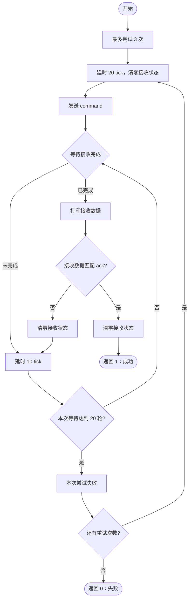

# `module_command_write` 流程图

函数位置：[source/bsp_module.c](../source/bsp_module.c)

```c
unsigned char module_command_write(char *command, char *ack)
```



- 最多发送 3 次。
- 每次发送后最多等待 20 轮，每轮延时 10 tick。
- 收到匹配的 `ack` 立即返回 `1`。
- 未匹配或超时则继续重试，全部失败后返回 `0`。
