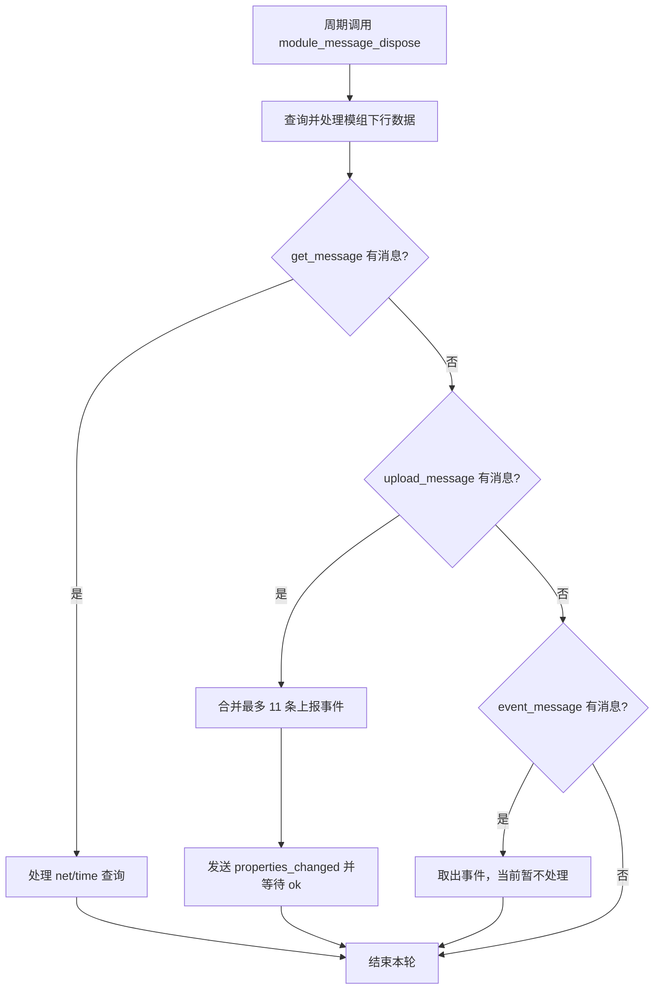

# `module_message_dispose` 数据通信流程说明

## 1. 函数定位

函数位置：[source/bsp_module.c](../source/bsp_module.c)

```c
void module_message_dispose(void)
```

`module_message_dispose()` 是模组数据通信的周期处理入口。任务循环每次调用该函数时，先查询模组是否存在下行数据，再按照队列优先级处理设备侧待发送或待读取的消息。

调用关系：

```text
Task4_Entry
  -> module_message_dispose()
```

`Task4_Entry` 每处理一轮后延时约 2000 个 FreeRTOS tick，具体时间取决于系统 tick 配置。

## 2. 单次处理顺序

函数的实际执行顺序如下：

1. 调用 `message_get_down()`，发送 `get_down\r` 查询模组下行数据。
2. 优先从 `get_message` 队列取一条消息。
3. 如果没有查询消息，再从 `upload_message` 队列取一条消息。
4. 如果没有查询和上报消息，再从 `event_message` 队列取一条消息。
5. 三个队列都没有消息时，本轮处理结束。

因此，队列处理优先级为：

```text
get_message > upload_message > event_message
```

注意：下行查询 `message_get_down()` 位于所有队列处理之前，每次调用都会执行。

## 3. 下行数据处理

`message_get_down()` 通过 LPUART1 发送：

```text
get_down\r
```

收到模组响应后，根据响应前缀分发：

| 模组响应 | 处理函数 | 当前行为 |
| --- | --- | --- |
| `down none` | 无 | 清除接收状态，结束本次下行处理 |
| `down MIIO_net_change ...` | `message_down_net()` | 更新 `module_param.net` |
| `down set_properties ...` | `message_down_set_properties()` | 修改属性并回复 `result` |
| `down get_properties ...` | `message_down_get_properties()` | 读取属性并回复 `result` |
| `down update_fw...` | 无 | 当前仅识别，不执行升级处理 |
| `down action ...` | 无 | 当前仅识别，不执行动作处理 |
| 其他响应 | 无 | 清除接收状态，结束本次下行处理 |

`message_get_down()` 每轮等待最多 5 次，每次等待后延时 10 个 FreeRTOS tick；如果收到完整响应，则立即解析并清除 `module_re_done`、`module_re_length`。

## 4. 查询队列处理

当 `get_message` 队列取到消息时，函数会先清空公共缓冲区 `rec_buf`：

- `msg_get_net`：发送 `net\r`，读取模组网络状态，再调用 `message_down_net()` 更新网络状态。
- `msg_get_time`：发送 `time\r`，读取模组时间；当前代码读取结果后没有继续解析或回复。
- 其他消息：取出后不执行具体操作。

该分支执行后，本次函数调用结束，不会继续处理 `upload_message` 或 `event_message`。

## 5. 上报队列处理

当 `get_message` 为空且 `upload_message` 有消息时，执行属性上报：

1. 清空 `rec_buf`。
2. 写入消息头 `properties_changed`。
3. 处理首条上报事件。
4. 最多再从 `upload_message` 取 10 条事件，并追加到同一条消息。
5. 追加 `\r` 和字符串结束符 `\0`。
6. 通过 `module_command_write()` 发送整条消息，并等待模组返回 `ok`。

因此一次调用最多合并 11 条上报事件：首次取出的 1 条，加上循环中最多追加的 10 条。

具体属性内容由 `message_update_ceate()` 根据事件类型生成，例如设备状态、故障、气体浓度、寿命、消音状态和身份识别码。

## 6. 事件队列处理

当 `get_message` 和 `upload_message` 都为空，且 `event_message` 取到消息时，进入事件分支。当前分支为空实现，仅取出消息，没有执行事件处理或发送响应。

## 7. Mermaid 流程图



## 8. 数据通信总览

```text
设备任务
  -> module_message_dispose()
     -> message_get_down()
        -> 模组下行命令解析与处理
     -> get_message
        -> net/time 查询
     -> upload_message
        -> properties_changed 上报
     -> event_message
        -> 当前未实现
```


flowchart TD
    A[系统运行] --> B{是否有 upload_message ?}
    B -- 是 --> C[打包属性上报]
    C --> D[message_update_ceate]
    D --> E[拼接 properties_changed]
    E --> F[module_command_write 发送上报]
    F --> G[结束此轮处理]

    B -- 否 --> H{是否有 event_message ?}
    H -- 是 --> I[事件处理分支]
    I --> G

    H -- 否 --> J{是否有 get_message ?}
    J -- 是 --> K{queuemessage == msg_get_net ?}
    K -- 是 --> L[module_command_read net]
    L --> M[message_down_net 更新网络状态]
    K -- 否 --> N{queuemessage == msg_get_time ?}
    N -- 是 --> O[module_command_read time]
    O --> G
    N -- 否 --> G

    J -- 否 --> P[message_get_down]
    P --> Q{读取 get_down 返回值}
    Q -- down none --> G
    Q -- down MIIO_net_change --> R[message_down_net]
    Q -- down set_properties --> S[message_down_set_properties]
    Q -- down get_properties --> T[message_down_get_properties]
    Q -- down update_fw/action --> G

    R --> G
    S --> G
    T --> G
