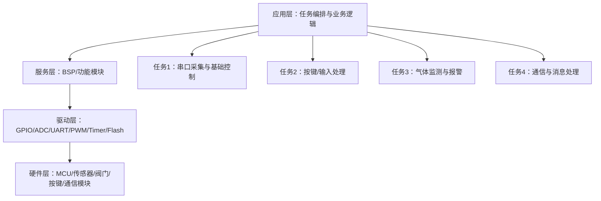
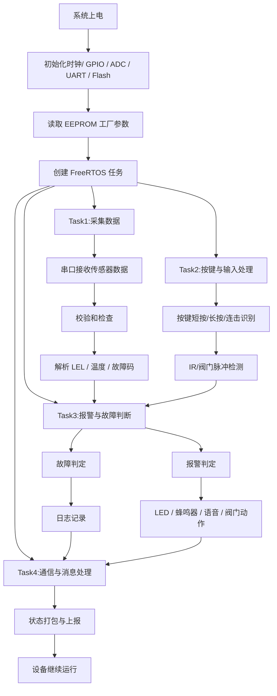

# 产品功能设计说明

## 1. 产品定位

本项目是一套基于 HC32L12x MCU 的气体检测控制产品，核心功能覆盖气体浓度采集、异常告警、按键交互、阀门控制、状态显示以及通信上报。产品整体采用 FreeRTOS 多任务架构，按功能拆分为：

- 任务1：采集与基础控制
- 任务2：按键与输入事件处理
- 任务3：气体监测与报警控制
- 任务4：通信与模块消息处理

从工程结构来看，产品逻辑主要由应用层任务、BSP 功能服务层和底层驱动层构成，符合典型的“应用 -> 服务 -> 驱动 -> 硬件”分层设计。

---

## 2. 功能设计目标

该产品的设计目标包括：

1. 可靠采集气体浓度数据并完成故障判断；
2. 对异常状态进行预警、静音、故障提示和日志记录；
3. 支持按键操作、IR 信号感知、阀门脉冲检测等用户交互；
4. 可通过通信模块完成状态上报、参数下发和远程识别；
5. 提供稳定的生命周期管理和 EEPROM / Flash 参数保存；
6. 保证系统在上电、预热、报警、故障和恢复等状态切换时具备良好的可维护性。

---

## 3. 功能架构概述

### 3.1 总体架构

### 3.2 关键模块

- 气体监测模块：处理传感器数据、故障判断和报警触发
- 按键/输入模块：处理短按、长按、连击、IR 和阀门脉冲信号
- 阀门控制模块：实现阀门动作、状态判断和学习校准
- 语音/LED/显示模块：输出工作状态、预热、异常提示
- 日志与参数模块：保存报警、故障和生命周期记录
- 通信模块：处理 PID、版本信息、状态帧和消息分发

---

## 4. 功能特性设计

### 4.1 系统初始化与参数管理

#### 功能描述
系统上电后执行初始化流程，包括：

- 时钟初始化
- GPIO 初始化
- ADC 初始化
- RTC 初始化
- PWM 初始化
- UART / LPUART 初始化
- Flash / EEPROM 参数读取
- 看门狗初始化
- FreeRTOS 任务创建

#### 设计意图
该阶段负责建立整个产品运行所需的基础环境，并保证系统参数可从 EEPROM / Flash 中恢复。工程中的 main.c 中明确执行了：

- Init_ClockSys()
- Init_gpio()
- Init_lptim0()
- Init_timer0()
- Init_usart0()/Init_usart1()
- Init_Adc()
- Init_rtc()
- Init_pwm()
- Flash_read_params()
- Flash_factory_check()
- Flash_factory_params()
- xTask_init()

#### 扩展处理
- 支持工厂校准参数的重新写回
- 支持 EEPROM 参数异常检测和恢复
- 支持系统上电时自动完成初始化和状态复位

### 4.2 气体采集与传感器数据处理

#### 功能描述
本产品的核心功能为气体浓度采样与状态判定，工程中的 bsp_gas.c 中已实现：

- 读取气体数据
- 解析传感器帧格式
- 计算校验和
- 解析 LEL、温度、故障码和状态值
- 更新 gas.value_lel、gas.value_fault、gas.value_temperature 等状态变量

#### 处理流程
1. 串口接收传感器原始数据；
2. 通过 calculate_checksum() 进行校验；
3. 若包含 A 开头的有效帧，则执行 gas_sensor_convert()；
4. 将解析后的浓度、温度和故障码写入内部状态；
5. 通过 gas_sensor_analysis() 更新设备当前运行状态。

#### 关键特性
- 传感器离线检测
- 故障位判定
- 浓度结果换算
- 校验和校验
- 采集结果上传/事件触发

#### 扩展点
- 增加多传感器轮询支持
- 增加采样平滑滤波和趋势分析
- 增加阈值策略配置化

### 4.3 报警与故障管理

#### 功能描述
该模块负责在检测到浓度异常或传感器故障时执行报警响应。通过 gas_judge_fault()、gas_sensor_alarm() 等逻辑实现：

- 故障进入/退出判定
- 传感器离线超时判断
- 报警状态触发
- 记录告警/故障日志
- 维持故障静音与报警静音状态

#### 典型行为
- 当检测到传感器离线时，触发故障状态；
- 当超出设定浓度阈值时，进入报警状态；
- 报警/故障退出后，恢复正常运行。

#### 扩展设计
- 增加一级/二级/三级报警策略
- 增加报警延时和抑制时间配置
- 增加远程告警上报（MQTT / NB-IoT / Modbus 分帧）

### 4.4 按键与输入事件处理

#### 功能描述
按键模块由 bsp_key.c 负责，核心功能包括：

- 按键扫描
- 短按 / 长按 / 连击识别
- 控制报警静音、故障静音、测试功能
- 识别 IR 信号
- 检测阀门脉冲

#### 关键逻辑
- key_scan()：周期扫描按键状态，并识别按键持续时间；
- key_fault_mute()：处理故障静音；
- key_alarm_mute()：处理报警静音；
- key_alarm_start()：处理测试/报警启动；
- PortA_IRQHandler()、PortD_IRQHandler()：处理外部中断。

#### 设计价值
按键输入是产品人机交互的核心入口，适用于：

- 手动静音
- 功能测试
- 设备维护
- 故障确认

#### 扩展点
- 增加防抖和重复按键过滤策略
- 支持不同按键组合功能
- 支持功能菜单式操作

### 4.5 阀门控制与状态校准

#### 功能描述
阀门控制模块是产品的执行机构控制模块，职责包括：

- 阀门动作控制
- 阀门学习与自校准
- 阀门状态判断
- 阀门故障检测
- 阀门执行后状态复位

#### 设计特点
- valve_open_set()：设置阀门动作起始和关闭时长；
- valve_study_handler()：通过脉冲宽度学习阀门参数；
- valve_judge()：根据学习宽度判定阀门开/关/故障；
- valve_check_handler()：检查阀门状态变化并生成事件。

#### 价值
该模块确保设备执行动作稳定，并能根据真实阀门特性进行适配，提升控制精度。

#### 扩展点
- 增加阀门动作周期策略
- 增加电磁阀故障分级
- 支持配置化阀门参数表

### 4.6 指示输出与人机反馈

#### 功能描述
产品通过 LED、语音、蜂鸣器和显示模块反馈设备状态，包括：

- 预热提示
- 正常工作状态
- 报警状态
- 故障状态
- 静音状态
- 阀门动作显示

#### 实现逻辑
工程中涉及：

- led_working()
- voice_working()
- buzzer_short()
- display_handler()
- display_preheat()

这些逻辑在 Task3 中被周期调用，以在 100ms 或 500ms 周期中更新工作状态。

#### 扩展点
- 增加多颜色状态编码
- 增加显示屏协议支持
- 支持语音播报内容定制

### 4.7 日志与 Flash 事件记录

#### 功能描述
日志模块用于保存关键运行事件，确保产品出现异常时能够回溯问题。相关实现位于 bsp_log.c 中：

- 事件记录：报警进入/退出、故障进入/退出、静音、断电/上电、寿命警告
- 日志压缩和清理
- 日志查询与消息封包
- Flash 擦除与重写

#### 关键特性
- 事件写入 Flash
- 日志按段存储
- 按时间检索事件
- 支持批量日志上报

#### 应用价值
有助于设备维护、售后分析和故障定位。

#### 扩展点
- 增加事件加密和签名
- 支持周期性日志上传
- 扩展日志分级与优先级

### 4.8 通信与模块消息处理

#### 功能描述
通信模块用于设备和外部控制器/云端之间的状态交互，主要处理：

- 模块识别、初始化和注册
- PID / 版本信息打包
- 状态消息上报
- 参数下发或命令处理
- 设备状态同步

#### 相关实现
工程中的 bsp_module.c 中提供：

- PackageIdentityCodeData()
- message_packet_finish()
- message_packet_param()
- get_device_status()
- get_device_fault()

#### 设计价值
- 提升遥控/远程诊断能力
- 支持设备联网/云端监控能力
- 便于后续扩展 MQTT 或其他物联网协议

#### 扩展点
- 增加 MQTT 协议支持
- 增加 OTA 升级
- 增加设备配置下发接口

### 4.9 设备寿命管理与保养策略

#### 功能描述
工程中有明确的寿命判断逻辑，支持：

- 功能寿命监测
- 低电量提示
- 设备使用周期管理
- 故障累计与状态上报

#### 设计价值
帮助设备实现保养提醒和使用周期管理，适合安全类检测产品的长期运行。 

#### 扩展点
- 增加使用寿命阈值配置
- 增加保养提醒计划
- 增加生产制造数据统计

---

## 5. 功能流程设计

---

## 6. 关键功能特性总结

该产品的核心功能特性可归纳为：

1. 高可靠气体检测：实时在线采集、解析与故障识别；
2. 多维状态管理：正常 / 预热 / 报警 / 故障 / 静音 / 离线；
3. 用户交互支持：按键、IR、阀门脉冲识别；
4. 执行机构控制：阀门学习、阀门状态检测和动作控制；
5. 可维护性：日志记录、参数存储、故障追踪；
6. 扩展通信能力：状态上报、版本和 PID 组包；
7. 设备生命周期管理：寿命、低电量、工厂保养策略。

---

## 7. 扩展子章节建议

### 7.1 功能扩展：网络通信扩展

- 接入 MQTT / NB-IoT / TCP 远程通讯
- 支持远程参数同步与设备控制
- 增加云端在线诊断能力

### 7.2 功能扩展：工厂测试能力

- 增加自动校准流程
- 增加产线自检和参数写入
- 增加一致性校验和随机抽检

### 7.3 功能扩展：诊断与运维

- 增加故障树诊断
- 支持日志查询、事件回放
- 支持批量远程噪声和参数采集

### 7.4 功能扩展：安全性设计

- 增加权限控制
- 增加防误触和防篡改机制
- 增加数据完整性校验和加密通道

### 7.5 功能扩展：算法升级

- 多点校准和联合校正
- 气体浓度平滑滤波与趋势分析
- 预测性维护和健康度评估

---

## 8. 结论

该项目的功能设计以“气体检测为核心、报警控制为关键、交互和通信为补充”的思路展开，体现了典型的工业控制产品架构：实时检测、状态处理、执行控制、数据存储与通信反馈并行协同。该设计具备良好的扩展性，便于进一步扩展到更高级的网络化、智能化和远程运维能力。